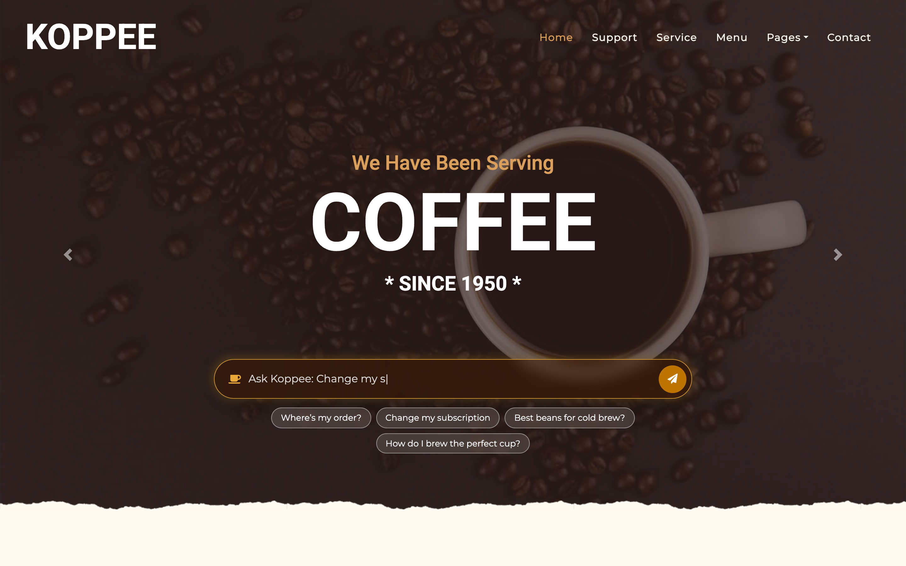
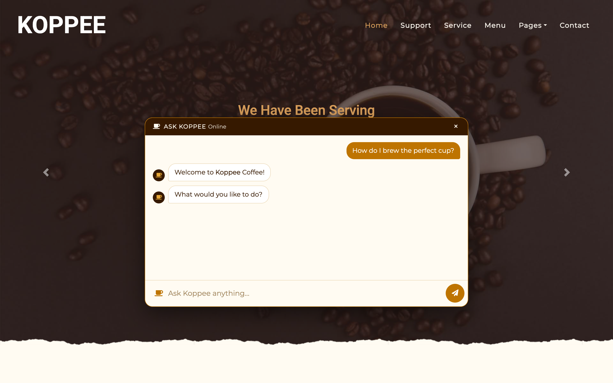

# Koppee Coffee — embedded AVA chat

A fork of the Koppee Coffee demo site where, instead of the Genesys Messenger widget, the home page has a **chat bar built into the hero** that talks to a Genesys Cloud AVA (virtual agent) through the same Messenger deployment.

| Closed | Open |
|---|---|
|  |  |

## What you get

- Frosted-glass bar over the hero image that expands upward into a full chat panel
- Rotating typed placeholder and one-click suggestion chips
- Typing indicator, quick-reply buttons, bot avatar, bold/italic/link rendering
- Session persists across reconnects (per browser tab)
- No backend and no build step: plain HTML/CSS/JS over the Genesys **Web Messaging guest API** (WebSocket)
- The stock Messenger widget is removed from `index.html` only; the other pages still use it

## Setup

1. Create (or reuse) a Genesys Cloud **Messenger deployment** routed to an inbound message flow that hands off to your AVA / bot flow.
2. In the deployment, add the domain that will host this site to **Allowed domains** (and `localhost` while testing).
3. Edit the `CONFIG` block at the top of [`js/ava-chat.js`](js/ava-chat.js):
   ```js
   deploymentId: 'YOUR_DEPLOYMENT_ID',
   domain: 'mypurecloud.com',   // your region, e.g. usw2.pure.cloud, mypurecloud.ie, mypurecloud.com.au
   ```
4. Replace `YOUR_DEPLOYMENT_ID` (and `environment`, e.g. `use1`) in the Messenger snippet at the bottom of `about.html`, `menu.html`, `service.html`, `contact.html` and `support.html` — or delete those snippets if you only want the embedded chat.
5. Serve the folder with any static host. Locally: `python3 -m http.server 8000`.

## Customising

- **Chips / placeholder prompts:** the `.ava-chat__chips` buttons in `index.html` and the `prompts` array in `js/ava-chat.js`.
- **Colours:** `css/ava-chat.css` (`#BE7400` gold, `#361900` dark brown, `#FFFBF2` cream).
- **Greeting:** the chat sends a Messenger "Presence Join" on connect so the flow's welcome fires, same as Messenger auto-start. Set `welcomeOnOpen: false` to wait for the visitor's first message.
- **Small screens:** below 768px the bar sits under the hero instead of overlaying it.

## Notes

- If your flow looks up a Predictive Engagement journey session, a custom chat won't have one unless you also load the Genesys tracking snippet. Handle the "no session" path in the flow.
- The open-state screenshot was captured against a demo flow with one flow-specific debug message hidden.
- The original demo flows and knowledge export live in the upstream repo: https://github.com/mitchmason4/mitchmason4.github.io

## Credits

Website template: KOPPEE – Coffee Shop HTML Template by [HTML Codex](https://htmlcodex.com/coffee-shop-html-template) (license in `LICENSE.txt`). Original Koppee Genesys demo by Mitch Mason; inbound flow by Terry Sullivan.
